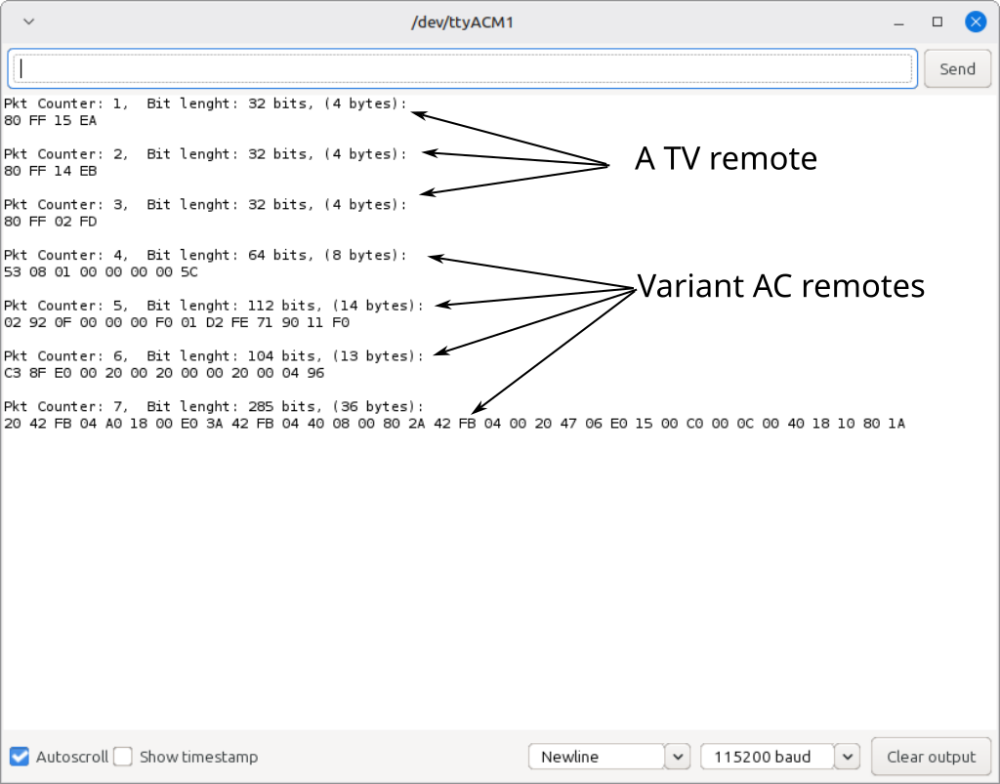
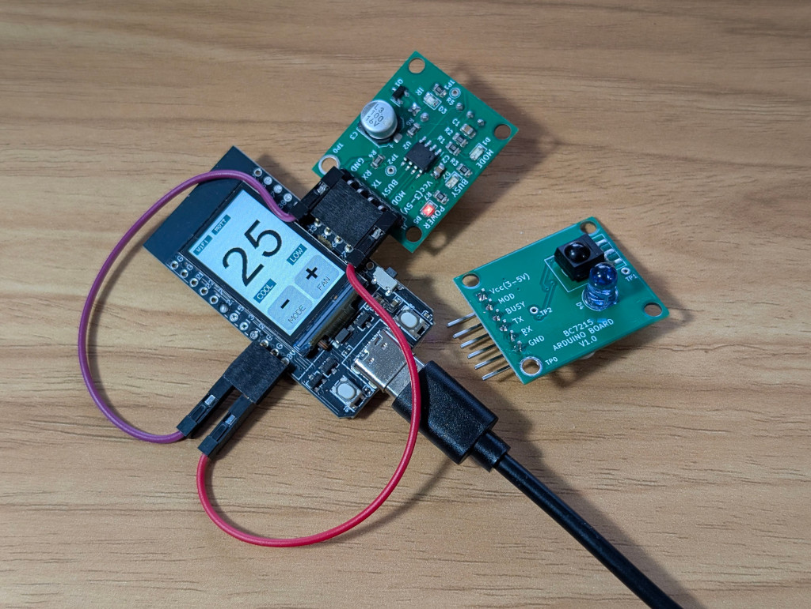
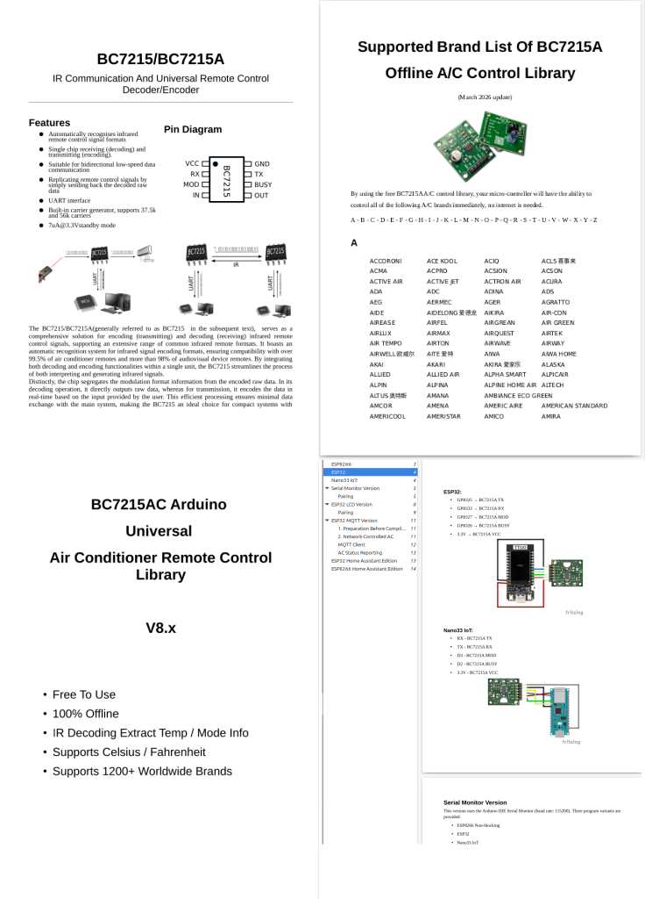

# BC7215AC Offline Universal Air Conditioner IR Control Library For Arduino

[[简体中文](./extras/doc/README_CN.md)]

****2 major functionalities of this library:****

* ##### Sending IR to control Temp, Mode, Fan & Power of an A/C

* ##### Receiving to extract these information from the IR

This repository contains **2 libraries**: A **low level driver library** and a dedicated **AC control library.** The low level driver library can be run on any Arduino including UNO, with the driver library itself it's already powerful enough to decode and duplicate any IR remote, or use 2 devices to setup your own IR communication system. a few example codes are provided.

With the AC library, any AC can be controlled and decoded offline, but it needs more resources, usually ESP32 or ESP8266 will be used. Examples for ESP32, ESP8266 and Nano33 are provided in the package.



*A screenshot of low level driver library example -- universal IR decoder*



*An ESP32 MQTT AC controller example with LCD*

# Installation

There are 2 ways to install:

- **In Arduino IDE library manager, search "BC7215"**

- **Download this repository and install as a zip file.**

# Documentation

Detailed information including datasheets and user manuals are placed in the extras/doc folder, 



Here is a tree of the repository contents:

```text
root/
├─ README.md                            <- This file
├─ src/                                 <- Source code
│  ├─ bc7215_ac_lib/                    <- base BC7215 lib & AC lib in C
│  ├─ bc7215.h                          <- BC7215 low level driver header
│  ├─ bc7215.cpp                        <- Low-level driver cpp wrapper
│  ├─ bc7215ac.h                        <- AC library header
│  └─ bc7215ac.cpp                      <- AC library cpp wrapper
├─ extras/
│  ├─ img/                              <- images for documents
│  ├─ config/                           <- TFT lib settings for examples
│  └─ doc/                              <- Documents
│     ├─ AC_control_examples.md         <- AC control examples manual
│     ├─ AC_control_examples.pdf        <- AC control examples manual
│     ├─ ac_lib_issue_feedback.pdf      <- Issue report form
│     ├─ bc7215_en.pdf                  <- BC7215 datasheets
│     ├─ BC7215AC_arduino_ac_lib.pdf    <- AC control library manual
│     ├─ bc7215_arduino_board.pdf       <- BC7215 Arduino board schematic
│     ├─ bc7215_arduino_examples_en.pdf <- Low-level lib examples manual
│     ├─ bc7215_arduino_lib_en.pdf      <- Low-level lib user manual
│     ├─ programming_flowchart_en.pdf   <- Programming flowchart
│     └─ Supported_ac_brand_list-en.pdf <- Supported AC brand list
└─ examples/
   ├─ ESP32_AC_LCD/                     <- ESP32 AC Control with LCD
   ├─ ESP32_AC_LCD_CN/                  <- ESP32 with LCD CN version
   ├─ ESP32_AC_MQTT/                    <- ESP32 AC Control with MQTT
   ├─ ESP32_AC_MQTT_CN/                 <- ESP32 with MQTT CN version
   ├─ ESP32_AC_MQTT_HA/                 <- ESP32 MQTT for Home Assistant
   ├─ ESP32_AC_Serial_Monitor/          <- ESP32 AC ctrl w Serial Monitor
   ├─ ESP32_AC_Serial_Monitor_CN/       <- ESP32 Serial Monitor CN version
   ├─ ESP8266_AC_MQTT_HA/               <- ESP8266 MQTT for Home Assistant
   ├─ ESP8266_AC_nonblocking/           <- ESP8266 AC with Serial Monitor
   ├─ ESP8266_AC_nonblocking_CN/        <- ESP8266 AC CN version
   ├─ Nano33_IoT_AC_Serial_Monitor/     <- Nano33 IoT AC control
   ├─ ir_decoder/                       <- Low-level: Universal IR decoder
   ├─ ir_switch/                        <- Low-level: IR controled switch
   ├─ prog_remote/                      <- Low-level: programmable remote
   └─ comm/                             <- Low-level: 2-way IR communicate

```

## Links to the documents:

[BC7215(A) datasheets](./extras/doc/bc7215_en.pdf)

[Supported AC brands list](./extras/doc/Supported_ac_brand_list-en.pdf)

[A/C Control Library User's Manual](./extras/doc/BC7215AC_arduino_ac_lib.pdf)

[User's Manual for AC control examples](./extras/doc/AC_control_examples.md)

[Low-level driver library User's Manual](./extras/doc/bc7215_arduino_lib_en.pdf)

[User's Manual for low-level library examples](./extras/doc/bc7215_arduino_examples_en.pdf)

[Programming Flowchart](./extras/doc/programming_flowchart_en.pdf)

[BC7215 Arduino Board Schematic](./extras/doc/bc7215_arduino_board.pdf)

## Other Documents:

A front page for the low-level driver library:

[**BC7215 CHIP DRIVER LIBRARY README FILE**](./extras/doc/README_BC7215_DRIVER.md)
