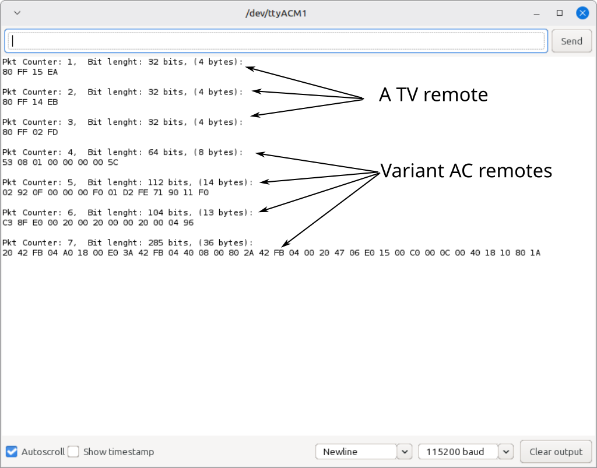
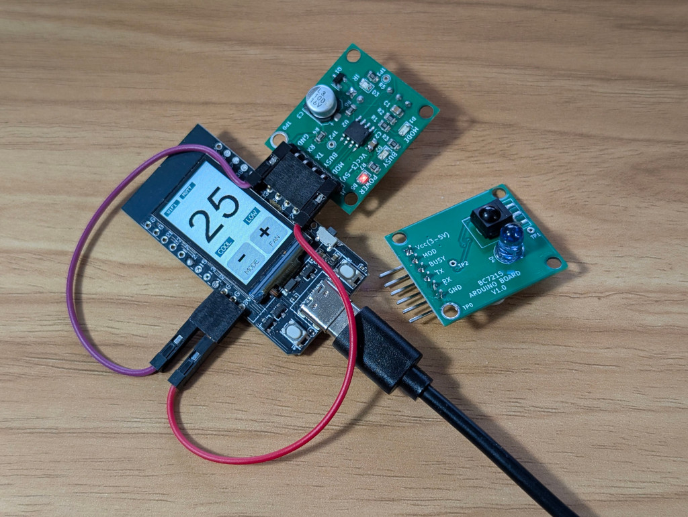
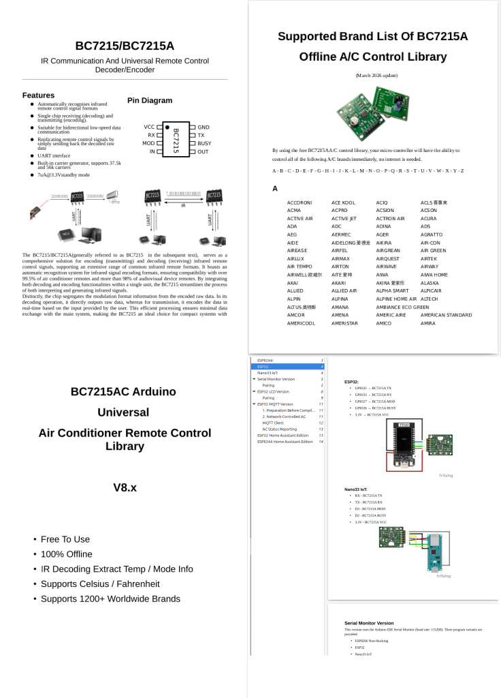

# BC7215AC 通用空调红外遥控库 For Arduino

[\[English\]](../../README.md)

**本库的2大功能：**

* ##### 离线发送红外信号控制空调的温度、模式、风力及电源

* ##### 离线解码红外信号读取其中的以上设置参数

本库实际包含2个独立库：芯片底层驱动库，及专用的空调控制库。底层驱动库可运行于任何ARDUINO架构上包括UNO，仅使用底层库，即可完整包括任意遥控信号编解码/复制等操作，也可使用2套设备完成红外通讯，已经随库提供了相应的例子。

使用空调控制库，可以完成任意空调的离线控制和解码，但空调库需要较多的资源，通常需要使用ESP32或ESP8266这样的ARDUINO. 随库提供了使用ESP32，ESP8266以及NANO33 的例子。



*底层驱动库的例程截屏 -- 万能红外解码*



*一个使用ESP32及板载LCD实现通过 MQTT 协议控制空调的例子*

# 安装

可通过两个方式安装:

- **在Arduino IDE的库管理器中搜索 "BC7215"**

- **从软件仓库中下载后手动用zip文件方式安装**

# 文档

详细的文档包括芯片技术手册、使用说明书等均放在 extras/doc 目录中。 



目录结构及其内容:

```text
root/
├─ README.md                            <- 本文件
├─ src/                                 <- 源文件目录
│  ├─ bc7215_ac_lib/                    <- 所依赖的C语言BC7215空调库
│  ├─ bc7215.h                          <- 底层驱动库头文件
│  ├─ bc7215.cpp                        <- 底层驱动库C++封装文件
│  ├─ bc7215ac.h                        <- 空调控制库头文件
│  └─ bc7215ac.cpp                      <- 空调控制库C++封装
├─ extras/
│  ├─ img/                              <- 文档所使用的图片
│  ├─ config/                           <- 例程所用TFT显示库设置
│  └─ doc/                              <- 文档目录
│     ├─ 空调遥控应用示例.md              <- 空调控制例程说明书md版
│     ├─ 空调遥控库应用示例.pdf            <- 空调控制例程说明书pdf版
│     ├─ ac_lib_issue_feedback.pdf      <- 问题上报表
│     ├─ bc7215.pdf                     <- BC7215 芯片技术手册
│     ├─ BC7215AC_arduino_空调遥控库.pdf  <- 空调控制库说明书
│     ├─ bc7215_arduino_board.pdf       <- BC7215 Arduino 板电路图
│     ├─ bc7215_arduino_examples_cn.pdf <- 底层驱动库例程说明书
│     ├─ bc7215_arduino_lib_cn.pdf      <- 底层驱动库说明书
│     ├─ programming_flowchart_cn.pdf   <- 编程流程图
│     └─ BC7215A码库空调品牌清单.pdf       <- 支持空调品牌清单
└─ examples/
   ├─ ESP32_AC_LCD/                     <- ESP32空调控制器LCD版
   ├─ ESP32_AC_LCD_CN/                  <- ESP32空调控制器LCD中文版
   ├─ ESP32_AC_MQTT/                    <- ESP32空调控制器MQTT版
   ├─ ESP32_AC_MQTT_CN/                 <- ESP32空调控制器MQTT中文版
   ├─ ESP32_AC_MQTT_HA/                 <- ESP32空调控制器Home Assistant版
   ├─ ESP32_AC_Serial_Monitor/          <- ESP32空调控制器串口监视器版
   ├─ ESP32_AC_Serial_Monitor_CN/       <- ESP32空调控制器串口监视器中文版
   ├─ ESP8266_AC_MQTT_HA/               <- ESP8266空调控制器Home Assistant版
   ├─ ESP8266_AC_nonblocking/           <- ESP8266空调控制器串口监视器版
   ├─ ESP8266_AC_nonblocking_CN/        <- ESP8266空调控制器串口监视器中文版
   ├─ Nano33_IoT_AC_Serial_Monitor/     <- Nano33 IoT空调控制器串口监视器版
   ├─ ir_decoder/                       <- 底层库例程：万能红外解码
   ├─ ir_switch/                        <- 底层库例程：红外控制开关
   ├─ prog_remote/                      <- 底层库例程：学习型红外遥控器
   └─ comm/                             <- 底层库例程：双向红外通讯

```

## Links to the documents:

[BC7215(A) 技术手册](./bc7215.pdf)

[支持空调品牌清单](./BC7215A码库空调品牌清单.pdf)

[空调控制库使用手册](./BC7215AC_arduino_空调遥控库.pdf)

[空调控制例程手册](./空调遥控库应用示例.pdf)

[底层驱动库使用手册](./bc7215_arduino_lib_cn.pdf)

[底层驱动库例程手册](./bc7215_arduino_examples_cn.pdf)

[编程流程图](./programming_flowchart_cn.pdf)

[BC7215 Arduino 板电路图](./bc7215_arduino_board.pdf)

## 其它文档

[**BC7215芯片底层驱动库资料首页**](./README_BC7215_DRIVER_CN.md)